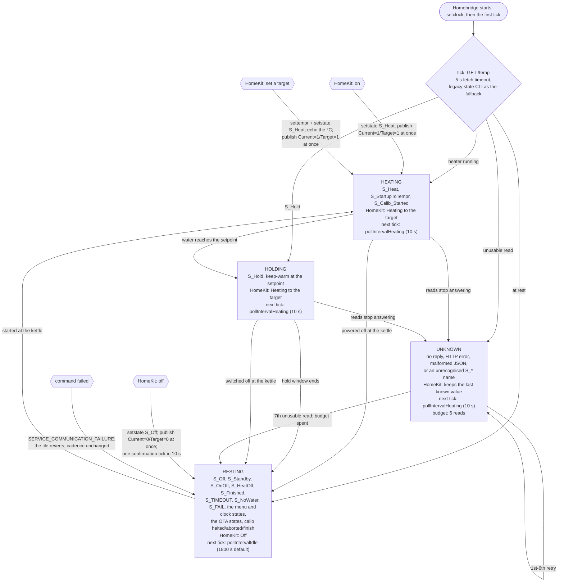

# homebridge-stagg-ekg-pro


[](https://www.npmjs.com/package/homebridge-stagg-ekg-pro)
[](https://www.npmjs.com/package/homebridge-stagg-ekg-pro)

[Pending Verification by Homebridge]
___

Homebridge plugin for the Fellow Stagg EKG Pro, talking to the kettle over Wi-Fi via its built-in HTTP CLI API.
* Set temperature
* Boil water ON/OFF


## Install

The plugin is published to [npm](https://www.npmjs.com/package/homebridge-stagg-ekg-pro). Install it into your Homebridge user directory (e.g. `/homebridge` in the Docker image), or use the plugin installer in Homebridge Config UI X:

```
npm install --save --omit=dev homebridge-stagg-ekg-pro
```

Then restart Homebridge.

The same version is also mirrored to [GitHub Packages](https://github.com/tomtastic/homebridge-stagg-ekg-pro/packages) as `@tomtastic/homebridge-stagg-ekg-pro` for anyone who prefers that registry:

```
registry=https://registry.npmjs.org/
@tomtastic:registry=https://npm.pkg.github.com/
//npm.pkg.github.com/:_authToken=<GitHub npm token>
```

## Config

```json
"platforms": [
    {
        "platform": "StaggKettle",
        "name": "Kettles",
        "kettles": [
            {
                "name": "Kettle",
                "url": "http://192.168.1.32",
                "minTemp": 40,
                "maxTemp": 100,
                "pollIntervalHeating": 10000,
                "pollIntervalIdle": 1800000,
                "syncTime": true,
                "timeZone": "Europe/London"
            }
        ]
    }
]
```

Each entry in `kettles` becomes one accessory in HomeKit.

| Field | Required | Description |
|---|---|---|
| `name` | yes | Name shown in HomeKit |
| `url` | yes | Base URL of the kettle. No trailing slash. |
| `minTemp` | no | Minimum target temp in °C (default: 40) |
| `maxTemp` | no | Maximum target temp in °C (default: 100) |
| `pollIntervalHeating` | no | Temperature polling interval while heating, in milliseconds (default: 10000 / 10 seconds) |
| `pollIntervalIdle` | no | Temperature polling interval while idle, in milliseconds (default: 1800000 / 30 minutes) |
| `syncTime` | no | Set the kettle clock to the host system's local time when Homebridge starts and once per day (default: `false`) |
| `timeZone` | no | IANA time zone name used for clock sync, e.g. `Europe/London`. Blank = the Homebridge host timezone |

The plugin polls the kettle at `pollIntervalHeating` while HomeKit shows it as
heating, and at `pollIntervalIdle` otherwise. HomeKit-visible heating covers both
the heater running and the kettle holding water at the setpoint, so a kettle that
has boiled and settled into a keep-warm window is still watched closely — that is
exactly the state in which you might switch it off, and the change has to arrive
in seconds rather than at the end of the idle interval. A kettle that is switched
off, standing by on its base or sitting in a menu only touches `/temp` at the
(potentially much longer) idle interval. HomeKit characteristic reads are served
from the last poll, and a live read only happens before the first successful poll,
so reads never wait on the kettle. Both intervals are configured per kettle.

The classification comes from the firmware's own state names:

| Firmware `state` | HomeKit | Poll cadence |
|---|---|---|
| `S_Heat`, `S_StartupToTempr` (ramping to the setpoint), `S_Calib_Started` | Heating | `pollIntervalHeating` |
| `S_Hold` (keep-warm at the setpoint) | Heating | `pollIntervalHeating` |
| `S_Off`, `S_Standby` (powered on, nothing running), `S_OnOff`, `S_HeatOff`, `S_Finished`, `S_TIMEOUT`, `S_NoWater`, `S_FAIL`, the menu/clock states, the OTA states, `S_Calib_Halted`/`_aborted`/`_finish` | Off | `pollIntervalIdle` |
| unreachable, unreadable, or a state name this plugin does not know | last known value | `pollIntervalHeating` for six reads, then `pollIntervalIdle` |

Anything the user does from HomeKit is reported back immediately, without waiting
for the next read: switching the kettle on or setting a setpoint publishes
*Heating* and moves polling to `pollIntervalHeating` for up to 30 seconds, so the
state and the rising temperature arrive in seconds. Switching it off publishes
*Off* and takes one confirmation read at `pollIntervalHeating` before resting at
`pollIntervalIdle`. Changes made at the kettle itself are picked up at the next
poll of the cadence it is currently in. Reads that yield no usable state are
retried at `pollIntervalHeating` six times and then rest, so a kettle that cannot
be read never polls fast forever — including one that was heating and then dropped
off the network.

Each kettle logs the cadence it resolved when Homebridge starts, which makes a
stale deployment or a surprising interval obvious from the log rather than from a
packet capture:

```
[StaggKettle] Kettle: homebridge-stagg-ekg-pro v1.2.4, reading /temp every 10000ms
while heating or holding temperature and every 900000ms otherwise.
```

### State changes and timeouts

The poll loop is a four-state machine: every tick is one `GET /temp`, and the state
the kettle reports decides both the HomeKit value and the delay until the next tick.
A command from HomeKit shortcuts into the same machine — it publishes immediately
rather than waiting for a tick, then takes a confirmation read at the fast cadence.



The same diagram as a standalone file: [`docs/polling-flow.mmd`](docs/polling-flow.mmd).

| Timeout | Value | Where it applies |
|---|---|---|
| `pollIntervalHeating` | default 10 000 ms | `/temp` cadence while HomeKit shows heating (heater or hold), during retries, and after a HomeKit command |
| `pollIntervalIdle` | default 1 800 000 ms | `/temp` cadence while resting, and the minimum gap between `CurrentTemperature` publishes when nothing is heating |
| heat confirmation window | 30 000 ms | how long a HomeKit start command holds the fast cadence without the kettle confirming |
| switch-off confirmation | one tick | single fast read after a HomeKit stop, then straight back to idle |
| unknown-read budget | 6 reads (60 s at the defaults) | consecutive unusable reads before the loop rests; bounds the fast cadence in every case |
| HTTP fetch | 5 000 ms | every `/temp` and `/cli` request; a failed `/temp` falls back to the legacy `state` CLI |
| clock sync | at startup, then every 24 h | the first `/temp` tick waits for the initial `setclock` so it cannot queue behind it |

#### Measured against the diagram

Captured on the LAN with `tcpdump` while the kettle boiled, held and was switched
off, configured with `pollIntervalHeating: 10000` and `pollIntervalIdle: 900000`:

| Edge in the diagram | Measured on the wire |
|---|---|
| set a target from HomeKit | `setsetting settempr <whole °F>` and `setstate S_Heat` back to back; the next read reports that setpoint |
| `S_Heat` ramp, then `S_Hold` | 30 consecutive fast reads, gaps 10.1-10.4 s (mean 10.11 s), across the ramp *and* the whole keep-warm window |
| HomeKit switch-off | `setstate S_Off`, then exactly one confirmation `/temp` 7.4 s later |
| switched off at the kettle | keep-warm on one tick, `S_Off`/`pwm=-10` on the next, so HomeKit flips within one heating interval |
| resting afterwards | next `/temp` 900.11 s later, and not one other request to the kettle in between |

### Target temperature precision

The kettle stores its setpoint in whole degrees Fahrenheit, so a HomeKit target
entered in °C is quantised to ~0.56 °C steps: 93 °C is held as 199 °F and the
kettle reports it back as 92.7778 °C. The plugin echoes the °C value you set for
as long as the kettle reports that same stored setpoint, so HomeKit keeps showing
93 °C instead of 92.8 °C. As soon as the reported target moves somewhere else —
turned on the kettle's dial, for example — the kettle's own value is reported
again, at the next read or poll.

## Firmware analysis

The HTTP interface this plugin uses was reverse engineered from the kettle's firmware
images. The full write-ups live in the
[project wiki](https://github.com/tomtastic/homebridge-stagg-ekg-pro/wiki), one page per release:

| Firmware | Analysis | Highlights |
|---|---|---|
| 1.2.26 | [v1.2.26 analysis](https://github.com/tomtastic/homebridge-stagg-ekg-pro/wiki/1.2.26) | Current firmware. Google Cloud IoT Core removed — the only remote dependency is the Fellow OTA server, which now also receives session telemetry. Kettle state is JSON at `GET /temp` (the CLI no longer prints `state`). Adds a triac thermal model, plateau/fast-rise boil heuristics, user calibration and direct heater-test/PWM endpoints. |
| 1.1.76SSP | [v1.1.76SSP analysis](https://github.com/tomtastic/homebridge-stagg-ekg-pro/wiki/1.1.76SSP) | Feature update over v1.1.75SSP: local `/upload` and `/uploadfw` firmware upload, RSA-PSS-signed OTA, an 8-language UI, factory reset, and the new `settempr`, altitude and units CLI commands. |
| 1.1.75SSP | [v1.1.75SSP analysis](https://github.com/tomtastic/homebridge-stagg-ekg-pro/wiki/v1.1.75SSP) | Baseline teardown: ESP32 architecture, cloud MQTT connectivity, the local HTTP API and observed CLI commands, device states, BLE GATT and default credentials. |

Every page covers the local HTTP/CLI interface, the BLE GATT services and Wi-Fi provisioning,
the cloud and OTA endpoints, firmware/ELF hashes for identification, and the changes from the
previous release.

## Wi-Fi CLI

Talks directly to the EKG Pro's built-in HTTP CLI (`/cli?cmd=...`). Requires firmware that supports `setstate` and `setsetting settempr`.

Firmware 1.2.26+ no longer prints `state` output from the CLI endpoint and instead serves the kettle state as JSON at `GET /temp` (e.g. `{"temp":24.86,"temp_set":93.0,"state":"S_Off"}` with °C values and the same `S_*` state tokens). The plugin reads `/temp` first and falls back to the legacy `state` CLI text for older firmware, so both are supported. Control commands (`setstate`, `setsetting`) are unchanged.

The firmware emits a bare `nan` for `temp` (invalid JSON) when the sensor has no reading, for example while the kettle is off its base. The plugin sanitizes this and keeps reporting the last known temperature; the kettle state and target remain available in that situation. If the kettle state cannot be read at all (e.g. a transient `/temp` failure on firmware 1.2.26, where the legacy `state` CLI no longer prints anything), the plugin reports a HomeKit communication failure so the last known values are kept rather than logging a plugin error.

Set `syncTime` to `true` to synchronize the kettle clock with the local time of the system running Homebridge during module initialization and once every 24 hours. The plugin uses the kettle's `setclock` CLI command.

Clock sync uses the host timezone by default, which is UTC in most Docker containers. Set `timeZone` to an IANA zone name (e.g. `Europe/London`, `America/New_York`) to set the kettle clock to a specific zone instead. An unrecognised name is logged once when Homebridge starts and clock sync falls back to the host timezone.

## Homebridge UI

A config schema is included — use the graphical form in Homebridge Config UI X to configure the plugin.

## Releasing

Releases go through the `publish` workflow, which runs the test suite when a `v*` tag is pushed and then:

- publishes `@tomtastic/homebridge-stagg-ekg-pro` to GitHub Packages (built-in `GITHUB_TOKEN`), and
- stages `homebridge-stagg-ekg-pro` on npmjs (`npm stage publish`, using the `NPM_TOKEN` repository secret).

npm is deprecating direct publishing by CI tokens (January 2027), so a staged version is not live until a maintainer promotes it — each release ends with one interactive approval.

1. Create a granular access token on npmjs: Access Tokens → *Generate New Token* → select the `homebridge-stagg-ekg-pro` package with **Read and write (stage only)**. Add it to the repository as the `NPM_TOKEN` secret (Settings → Secrets and variables → Actions).
2. Cut the release:

```
git commit -am "Bump version"   # bump "version" in package.json first
git tag v1.1.2
git push tomtastic main v1.1.2
```

3. Approve the staged version on npmjs. This requires the `trcm` npm account (with 2FA enabled) to be logged in locally — `npm login` once — and the code from your authenticator app. `npm stage list` shows the pending stage and its id:

```
npm stage list
npm stage approve <stage-id> --otp <code>
```

`npm stage view <version>` and `npm stage download <version>` let you inspect a stage before approving; `npm stage reject <version>` discards it. Once approved the version is live on npmjs and Homebridge UI shows the update. Each release needs a new version — republishing an existing version fails.
